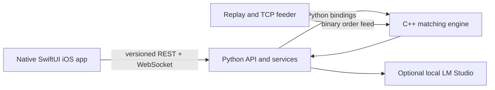

# AstraX

AstraX is a simulated exchange built around a C++ matching engine, Python services and a native SwiftUI iOS client. It is paper trading only; it does not connect to a broker or execute real trades.

## Architecture



The engine owns order matching and integer-tick prices. Python provides bindings, simulation and agent orchestration, replay tools, and service APIs. AI analysis is optional and runs through the Python service. The former browser dashboard and Expo/React Native client have been removed.

## Repository layout

```text
engine/       C++ matching engine, order book, protocols and benchmarks
bindings/     Python bindings for the C++ engine
backend/      Versioned FastAPI mobile service, PostgreSQL models and migrations
dashboard/    Legacy Python simulation service and AI helpers
data/         Replay, synthetic data and TCP feeder
agents/       Example trading agents
rl/           Reinforcement learning environments and training
simulation/   Python simulation orchestration
tests/        Python tests
docs/         API and engineering documentation
ios/          Native SwiftUI app, local Swift packages and API contract models
```

## Build and run

Build the C++ project:

```bash
cmake -B build -DCMAKE_BUILD_TYPE=Release
cmake --build build
ctest --test-dir build --output-on-failure
```

Run Python tests after building the bindings and installing project dependencies:

```bash
PYTHONPATH=build/bindings:. python3 -m pytest tests/ -v
```

Start the Python simulation service:

```bash
PYTHONPATH=build/bindings:. python3 dashboard/server/app.py
```

The legacy service exposes its WebSocket, binary TCP feeder, and JSON HTTP interfaces on localhost ports 8765, 8766, and 8767. The new mobile service setup and versioned contract are documented in [backend/README.md](backend/README.md) and [backend/openapi.yaml](backend/openapi.yaml).

Replay market data into the engine:

```bash
PYTHONPATH=build/bindings:. python3 -m data.tcp_feeder --source path/to/lobster.csv
```

## Price representation

Prices and quantities in the matching engine are integers. The current service documentation describes the fixed-point display scale and API payloads. Keep prices in integer ticks across service and client boundaries; convert only for display.

## Optional AI analysis

The Python AI helpers can use a local LM Studio server. Configure `LM_STUDIO_BASE_URL`, `LM_STUDIO_MODEL`, and `LM_STUDIO_EMBED_MODEL` in the environment. The simulator can run without LM Studio; AI analysis is unavailable in that case.

## Client status

The browser frontend and Expo client have been removed. A native SwiftUI app vertical slice is present under `ios/`; it has not yet been built or profiled with Xcode in this Windows workspace.

## Project explanations

- [iOS app](docs/ios_explanation.md)
- [Python backend](docs/python_explanation.md)
- [C++ engine](docs/cpp_explanation.md)
